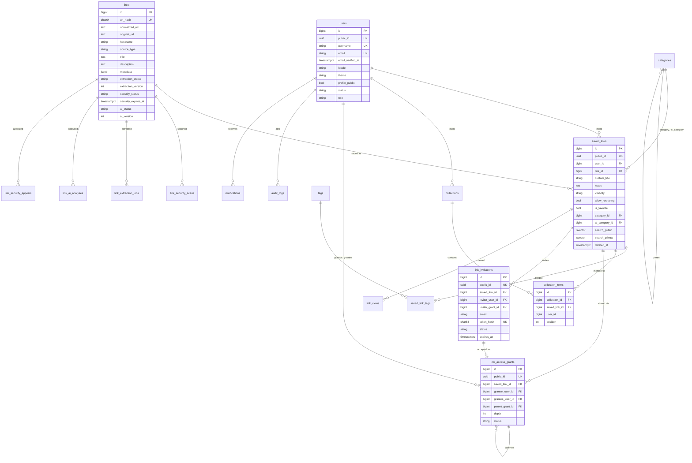

# Database (PostgreSQL)

Laravel framework tables are also present: `password_reset_tokens`, `sessions`, `cache`, `cache_locks`,
`jobs`, `job_batches`, `failed_jobs`, `personal_access_tokens`, `migrations`.

## Key decisions

| Decision | Reason |
|---|---|
| `links` (canonical) vs `saved_links` (per user) | One fetch/scan/AI analysis per URL; all private data isolated per user |
| `UNIQUE (user_id, link_id)` on saved_links (including soft-deleted rows) | Concurrency-safe dedup; re-saving restores the deleted row as PRIVATE |
| `UNIQUE (url_hash)` + `INSERT … ON CONFLICT DO NOTHING` | Race-free canonical link creation |
| Composite FKs `collection_items (collection_id, user_id) → collections (id, user_id)` and `(saved_link_id, user_id) → saved_links (id, user_id)` | The database itself forbids putting another user's link into a collection |
| Grants as explicit edges with `parent_grant_id` | Explicit lineage → well-defined cascading revocation and independent paths |
| Partial unique index on ACTIVE grant edges; partial unique index on PENDING invitations | No duplicate active edges / pending invitations, history preserved |
| `CHECK` constraints on all enum-like columns, lowercase e-mail, username format, `revoked_at` consistency, no self-grants | Invalid states cannot be stored even by bugs |
| UUIDv4 `public_id` everywhere exposed; bigint internal keys | Non-enumerable identifiers; compact joins |
| `timestamptz` | Unambiguous times across time zones |
| JSONB only for flexible provider data (`links.metadata`, scan `provider_results`, AI tags, audit metadata) | Relational data stays relational |
| Two tsvector columns + GIN indexes | Private notes can never leak through public/viewer search |
| Partial indexes for the public feed (`published_at`, `popularity_score WHERE visibility='PUBLIC' AND deleted_at IS NULL`) | Fast discovery pages |
| Soft deletes only on `saved_links` | Restore support; grants/invitations are revoked on delete regardless |
| `link_views (saved_link_id, viewer_hash, viewed_on)` unique | One view per viewer per day (abuse-resistant popularity) |

## Delete behaviour

- Deleting a user cascades to their saved links, collections, grants (as grantor/grantee), invitations,
  appeals and views. Before deletion every grant/invitation involving the user is revoked through the
  service so dependants are revoked and audited; notifications are removed; audit rows keep `actor = NULL`.
- Canonical `links` are `RESTRICT`ed while any saved link references them and pruned by the scheduler 30 days
  after the last reference disappears.
